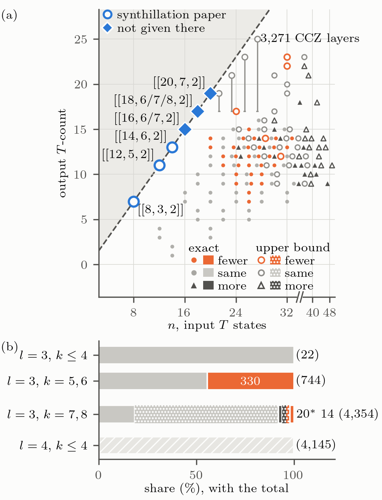
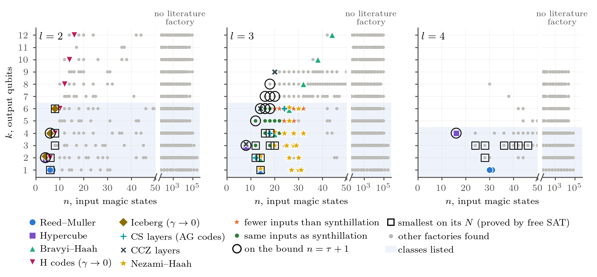

# Magic State Factory Search

Code and data for:

> S. Singh, C. Gidney, C. Jones, **"Distillation Factories as Borrowed Identities,"**
> [arXiv:2606.28518](https://arxiv.org/abs/2606.28518) (2026).

A distillation circuit need only return one state, `|+>^N`, to itself: a *borrowed identity*. For circuits of
`Z(pi/2^l)` parity rotations this is one phase condition on the rotation coefficients, the same at every level `l`
of the Clifford hierarchy (`l=2`: `S`, `CZ`; `l=3`: `T`, `CS`, `CCZ`; `l=4`: `sqrt(T)`, ..., `CCCZ`). This repository
solves that condition for distance-2 factories, labels every factory by the exact Clifford class of the state it
deposits, and holds every factory found with its circuit. The paper cites the repository as a whole; the table
[Paper claims and where they are checked](#paper-claims-and-where-they-are-checked) below maps each claim to its
script and output file.

## What the search finds

<p align="center"></p>

**Fig. 2 of the paper.** (a) The smallest factory found for each of the 766 output classes at `l=3`, `k<=6`, at the
exact T-count of its target, against the bound `n >= T-count + 1` (dashed). Only the factories on the line (5 of the 766)
are proved the smallest distance-2 factories of this form at any size; the others are the smallest found. (b) Against synthillation: fewer inputs for 330 of the 766 classes, the same for 436, more for none; a factory
for every one of the 4,145 classes at `l=4`, `k<=4` that need a fourth-level rotation (the other 22 of the 4,167 listed
are third-level targets, flagged `third_level_target` in `outputs/staged_best.json` and covered at `l=3`). Script: `searches/plot_frontier.py`.

<p align="center"></p>

**Fig. 4 (End Matter).** Every factory found at `l=2,3,4`, with the literature factories among them by family (Reed--Muller,
hypercube, Bravyi--Haah, H codes, Iceberg, `CS` layers of the AG codes of Gong et al., `CCZ` layers of synthillation,
Nezami--Haah: 19 of its 68 sizes, every size at which a stage met a `T^k` factory where the classes are listed). Shaded: the cells with a class list (every stage); the rest is the same search with lighter choices (below). Rings: on the bound, including the `CCZ` layers at `k=7,8`. Linear in `n` to
50, past every literature factory; logarithmic beyond, to `N = 18` qubits (`n` up to `2^18 - 2 = 262,142`, the range of the search rather than useful factories). Script: `searches/plot_literature.py`.

## The search

The search solves the borrowed-identity condition in three stages. Each stage holds part of the circuit fixed, is
asked only for a factory with fewer inputs than the best found so far for each output class, and passes the best on.
Every factory any stage finds is verified against the condition, with distance at least 2, and credited to the exact
output class it deposits.

1. **Symmetry** (`searches/staged.py` passes `i_tg`, `i_gs`, `i_gh`). Two-group circuits, outputs and checks each
   symmetric (`unified_search.stage_two_group`, closed-form binomial sums); group-symmetric circuits, outputs under a
   group `G` of their permutations and checks symmetric (`searches/orbit_group.py`), swept over a menu of groups or aimed
   at one listed class with `G` its symmetry group; and the same with a group `H` on the checks
   (`searches/orbit_group2.py`).
2. **Gluing** (`ii_dj`, `ii_eg`). Fix the rotations on the outputs alone, to symmetric blocks on disjoint outputs
   (`searches/cascade.py`) or to an optimal synthesis of a listed class (`searches/entangled_gluing.py`,
   `entangled_gluing_l4.py`), and solve the linear system for the check couplings bit by bit over `Z_{2^l}`.
3. **SAT** (`iii_r`, `iii_f`). At `l=3` an even coefficient is a Clifford rotation, so a factory is a set of
   rotations and the condition is parity equations over `F_2`, passed to CryptoMiniSat 5.17.0 as XOR constraints
   with a cardinality bound (`searches/xor_sat2.py`). Restricted: each rotation's output part drawn from a synthesis
   of the target (optimal parity network, Lempel factors for `mu` and `mu+1`, linear-term column; computed in a fresh
   z3 context by `searches/det_parts.py`), supports unlimited then `<= 6`. Free: only the number of qubits fixed,
   supports `<= 5`, `<= 6`, then unlimited. Every query in a fresh process (`searches/chain_iii2.py`). Minimality
   proofs on `N` qubits come from sweep A's free query over all coefficients with z3 (`searches/quick_sat.py`,
   `searches/sat_certify.py`), which fixes no output parts.

Every solver query is bounded by a deterministic limit (z3 steps; CryptoMiniSat conflicts in stage (iii); CP-SAT deterministic time, one thread, seed 0, in the group-symmetric stage (i)), so
the result does not depend on the machine. The exact output classes come from `searches/target_classes.py` (counts by
Burnside's lemma) and `searches/enumerate_targets.py`, `enumerate_targets_fiber.py`, `enumerate_targets_2adic.py`
(one representative per class and an exact labeller), used through `searches/cascade_class.py`.

**One search, three regimes.** The same cascade runs everywhere; what changes with the regime is which forms of each
stage are affordable. Every number in the paper comes from one of them:

| regime | stages run | code | outputs | in the paper |
|---|---|---|---|---|
| classes listed: `l=2,3`, `k<=6`; `l=4`, `k<=4` ("sweep A") | all of (i)-(iii), per class | `staged.py`, `staged_class.py`, `staged_best.py` | `outputs/staged_best.json` (from `staged_final_b3` at `l=3`, `staged_small`, `staged_l4fix`, `staged_A` at `l=4`, `k=4`) | Table I, Fig. 2 (766 points, panel b), the 330, Tables SII and SIV(a,c), the Gong table (SIII), Corollary 3 check |
| `l=3`, `k=7..9`, beyond the class lists | (i) two-group and group-symmetric (`b_stage_i.py`; `k=8,9` partial: 7 and 16 of 59 combinations hit the run limit); (ii) disjoint gluing (`k789_ii_dj.py`); for `CCZ` layers on a target list (ii) entangled gluing (`k78_eg.py`) and (iii) fast free SAT (`k78_xor.py`) | see "Reproducing the cascade beyond the class lists" | `outputs/staged_B/`, `outputs/k78_pipeline/` | Fig. 2 labels at `k=7,8`, Table SIV(b) `k=7,8` rows, End Matter "Beyond six outputs", Corollary 3 check (724 factories), Fig. 4 at `k=7..9` |
| the wider range: `l=2,3,4`, `k<=12`, `N<=18` (16 at `l=4`) | only the cheap forms: (i) two-group and (ii) disjoint gluing | `large_unified.py`, `merge_large_unified.py` | `outputs/large_unified_factories.csv`, `outputs/large_unified_with_quirk.csv.zip` | Fig. 4 beyond the shading, Table SI (families), the reach `k=12`, `n=262,142` |

`outputs/beyond_class_lists_with_quirk.csv.zip` (`searches/export_beyond_csv.py`) collects the last two regimes in the
column layout of `smallest_per_class.csv`, with a `regime` column and a Quirk link for every factory on at most 14
qubits (7,832 rows; every `l=3`, `k=7..9` factory re-verified as it is written).

## Reproducing sweep A (the staged cascade on every cell with a class list)

The large cells (`l=3, k=5,6`; `l=4, k=4`) ran stage by stage on the cluster, one task per class, so every stage's
gain and time is recorded separately; the small cells ran the same passes in one process each (below). Code:
`searches/staged.py` (passes and settings), `searches/staged_class.py` (cluster driver), `searches/check_A.py`
(verification). Environment of the run: Python 3.11.17, OR-Tools 9.15.6755, z3 5.3.2, NumPy 2.4.6.

**Settings** (stages (i)-(ii): `staged.DEFAULT`; stage (iii) at `l=3`: the chains of `searches/chain_iii2.py` in the three runs v4, v5, v6, the best per class assembled by `searches/build_staged_best3.py`; recorded in every output file under `settings`):

| pass | stage | settings |
|---|---|---|
| `i_tg` | (i) two-group, `S_k x S_r` | `nmax=11` circuit qubits, `smax=7` |
| `i_gs` | (i) group-symmetric, `G <= S_k` (`l=3`) | sweep over the group menu with up to `rmax=4` checks; then per class target mode `G=Aut(U)` and `G={e}` (`k<=6`), CP-SAT, `dlimit=20` deterministic s |
| `i_gh` | (i) `G x H`, check group `H <= S_r` | `rmax=4`, at most 24 free bits per cell |
| `ii_dj` | (ii) gluing, disjoint blocks | `rmax=4`, `smax=7` |
| `ii_eg` | (ii) gluing, entangled support | `rmax=4`; at `l=4` the inverse circuit is offered to the inverse class |
| `iii_r` | (iii) restricted SAT (`l=3`) | XOR form, `N=k+1..k+3`, `2e6` conflicts per query; supports unlimited (`xs:None:2e6`), then `<= 6` (`xs:6:2e6`); seeded with the best `n` after `ii_eg` |
| `iii_f` | (iii) free SAT (`l=3`) | XOR form, `N=k+1..k+3`, `2e6` conflicts per query; supports `<= 5`, `<= 6`, unlimited (`x:5:2e6`, `x:6:2e6`, `x:None:2e6`). Minimality proofs: sweep A's `coef:1.5e9:unseeded` (z3 over all coefficients, step limit `1.5e9`) |

Every factory any pass finds is verified (`unified_search.is_factory`, distance not 1) and credited to the exact
class it deposits, which need not be the class the query aimed at. Restricted SAT is skipped for a class whose best
`n` already equals `tau(U)+1` (Corollary 3).

**Commands.** All from the repository root; `OUT=outputs/staged_A`. Each line is one independent single-core task, so
the order within a step does not matter:

```
# 1. cell sweeps, one task per cell (stage (i) sweeps and disjoint gluing; no class list needed)
python searches/staged_class.py --cell 3 5 OUT;  python searches/staged_class.py --cell 3 6 OUT;  python searches/staged_class.py --cell 4 4 OUT
# 2. per class, seeded with the best n of the cell files: i_gs target mode, ii_eg (the chunk's own iii_r, check-pattern and z3 synthesis SAT, is superseded by step 3)
#    for (L,k,M) in (3,5,65) (3,6,679) (4,4,4082): for I in 0..M-1:
python searches/staged_class.py --chunk L k I M OUT
python searches/staged_class.py --merge L k OUT                # -> OUT/l{L}_k{k}/{i_tg,i_gs,i_gh,ii_dj,ii_eg}.json
# 3. stage (iii) at l=3, one task per class, seeded with the best n after ii_eg (outputs/solver_v2/staged_A_v4)
python searches/chain_iii2.py k I M OUT outputs/solver_v2/staged_A_v4 xs:None:2e6,xs:6:2e6,x:5:2e6,x:6:2e6,x:None:2e6,syn   # syn: z3 synthesis, ran last, lowered none, not in the pipeline
python searches/chain_iii2.py k I M OUT outputs/solver_v2/staged_A_v5 xsb:8:None:2e6,xsb:8:6:2e6,x:5:2e6,x:6:2e6,x:None:2e6
python searches/chain_iii2.py k I M OUT outputs/solver_v2/staged_A_v6 xs:None:2e6,xs:6:2e6,x:5:2e6,x:6:2e6,x:None:2e6,xsb:8:None:2e6,x2:5:2e6,x2:6:2e6,x2:None:2e6
python searches/merge_A_v3.py outputs/solver_v2/staged_A_v4     # per-form pass files (likewise _v5, _v6)
python searches/build_staged_best3.py                           # -> outputs/staged_final_b3/l3_k{1..6}: per class the best of v4, v5, v6
python searches/build_staged_final.py                           # (earlier v4-only build) -> outputs/staged_final/l3_k{1..6}
# minimality proofs (free query over all coefficients, z3): one task per class
python searches/staged_class.py --free 3 k I M coef:1.5e9:unseeded OUT
# 4. checks
python searches/check_A.py 3 5;  python searches/check_A.py 3 6 I 8;  python searches/check_A.py 4 4 I 16
python searches/staged_compare.py --L 3 --k 5 6 --out OUT       # against every earlier source
```

The small cells use the same stages (i)-(ii); at `l=3`, `k<=4` stage (iii) is step 3 as for `k=5,6`. At `l=2` and `l=4` there is no restricted SAT, and free SAT is z3 (`quick_sat`, `staged.DEFAULT` iii_f):

```
# l=3, k<=4: as above with OUT=outputs/staged_pc, M = number of chunks (2 were used)
python searches/staged.py --L 4 --k 3 --out outputs/staged_l4fix --jobs W        # l=4, k=3
python searches/staged.py --L 2 --k 1 2 3 4 5 6 --out outputs/staged_small --jobs W
python searches/staged.py --L 4 --k 1 2 --out outputs/staged_small --jobs W
# 5. one file for the paper: best factory per class over all cells, re-verified, with tau, synthillation n and c
python searches/staged_best.py                                  # -> outputs/staged_best.json (4,942 classes)
```

`staged.py` runs the passes `i_tg ... iii_f` in order in one process and writes one file per pass, the same
schema as the merged per-class files. Restricted SAT and the group-symmetric passes run at `l=3` only; free SAT runs
at `l=2, 3` and at `l=4` for `k<=3`.

**Environment.** `requirements.txt` pins the exact packages of the cluster runs (x86_64 Linux, CPython 3.11.17):

```
uv venv --python 3.11 && uv pip install -r requirements.txt
```

The small cells of sweep A that ran on a laptop used arm64 macOS, CPython 3.9.6, z3 4.16.0, OR-Tools 9.15.6755.

**What makes the result reproducible.** Every solver query has a deterministic limit (z3 steps; CryptoMiniSat
conflicts) and runs in a fresh process given only its inputs, and every synthesis it uses is computed in a fresh z3
context (`searches/det_parts.py`). Answers are therefore independent of the order of the classes and of the x86_64
host: stage (iii) gives identical per-stage results in forward and reverse class order on every x86_64 host tested
(Intel E5, Intel Platinum and Gold, AMD 7742/7763/9634; cluster jobs 2045426-9, 2049612-4). They are not the same across architectures: on arm64 one query reached the
same `n` only at a higher conflict limit, so rerun on x86_64. The cells first run on the laptop were rerun on x86_64 and give the same final `n` for 116 of 116 classes (`outputs/checks/x86_rerun_compare.json`). Every factory is verified independently of the solvers
(`unified_search.is_factory`, the brute-force phase table, `unified_search.distance`, the exact class labeller), and an
unsatisfiable answer is a proof on any machine.

**Two history effects, found and removed.** (1) Before 2026-11-02 08:16 `searches/pattern_sat.py` built its z3 queries
in the global context, so check-pattern SAT steered the synthesis-SAT query run after it in the same process
(replaying sweep A's task for class `2320:771` gives 30 with the old code and 28 with the current one). (2)
`synthillation_compare.opt_B` returns one of many valid Lempel factors and, in z3's global context, which one depended
on every earlier z3 call; this fed the allowed output parts of restricted SAT. The final stage (iii) removes both
(`chain_iii2.py`, `det_parts.py`; check-pattern SAT and z3 synthesis SAT are no longer part of it). Factories that the
history-dependent runs found and the final pipeline does not reproduce are kept, verified, in
`outputs/outside_pipeline/` (1 class; 35 with stage (iii) from v4 alone), together with 3 classes where the arm64 SAT-without-stages-(i)-(ii) test (Test A) ends 2 inputs below the x86-64 pipeline, with an explanation; the paper does not use them in its counts. The synthillation benchmark
was recomputed with the fixed `opt_B` and is unchanged on all 766 classes (`outputs/solver_v2/optB_strongest_compare.json`).
A wall-clock guard of 1 h per z3 query in sweep A is removed; a direct test shows it changed no answer.

Seeds come from the cell files only, so a class may start from a looser bound than in a one-process run of
`staged.py`. The merge takes the smallest `n` over everything found, so this changes the time a class takes, not
its final `n`, except where a query hits its limit.

**Cluster.** One core per task on LSF, `bsub -n 1 -W <minutes>`; the task lists are the lines above. Step 1 took
about 3 min wall, step 2 about 4 h, step 3 about 7.1 h, on up to 400 concurrent tasks. CPU time per pass and class
is in each output file (`seconds`, `seconds_are_cpu_sum`) and in `OUT/l{L}_k{k}/cls/*.json` (`per_class_seconds`).

**Expected result.** `outputs/staged_best.json`: 4,942 classes, every factory re-verified; at `l=3`, against the
strongest synthillation (`outputs/synthillation_strongest_l3.json`), fewer inputs for 330 of the 766 classes with
`k<=6` (243 by 2 inputs, 87 by 4; 834 inputs fewer in total), the same for 436, more for none; 5 on the bound
(`outputs/stage_contributions_l3.json`, `outputs/checks/sat_variants.json` best_of_three). Restricted-SAT layers lower 348
classes and free-SAT layers 92, in the winning run's own layer order (`form_lowered` in `outputs/staged_final_b3/summary.json`).
With stage (iii) from v4 alone (`outputs/archive/v4_published/`) the counts were 295 (243, 52), 471, 694 inputs.

**Stage (iii) with different SAT layers** (`l=3`, 766 classes with `k<=6`; `outputs/checks/sat_variants.json`, from
`python searches/sat_variants.py`). The three runs share stages (i)-(ii) and the gluing seed and differ only in the SAT
layers; `xs` = restricted SAT on one synthesis, `xsb:8` = restricted SAT over up to 8 syntheses, `x`/`x2` = free SAT,
the number after the colon the support-width limit (`None` = any), every layer at 2e6 conflicts. CPU hours are summed
over single-core tasks. "Fewer" counts classes with fewer inputs than the strongest synthillation construction.

| run | SAT layers | restricted / free layers | CPU-h restricted | CPU-h free | CPU-h total | fewer (of 766) | inputs fewer |
|---|---|---|---|---|---|---|---|
| v4 (time table, Table SII) | xs:None, xs:6, x:5, x:6, x:None | 2 / 3 | 52.9 | 121.0 | 173.9 | 295 | 694 |
| v5 | xsb:8:None, xsb:8:6, x:5, x:6, x:None | 2 / 3 | 288.1 | 119.7 | 407.8 | 328 | 826 |
| v6 (pipeline kept) | v4's five, then xsb:8:None, x2:5, x2:6, x2:None | 3 / 6 | 254.5 | 242.0 | 496.5 | 330 | 832 |
| best of v4, v5, v6 per class (paper's numbers) | - | - | - | - | 1,078.2 (sum of the three) | 330 | 834 |
| without SAT (stages (i)-(ii) only) | none | 0 / 0 | 0 | 0 | 0 | 95 | 194 |

The costly layer is `xsb:8:None`: 203.3 CPU-h in v5 (first layer, lowers 373 classes, 1,220 inputs) and 200.7 CPU-h in
v6 (after v4's five layers, lowers 67 more, 136 inputs). In v6, `x:None`, `x2:6` and `x2:None` changed `n` on none of
2,283 runs (`v6_idle_layers`). The best of the three is below v6 on one class (`6:2352:8688`, from v5). The z3 synthesis
layer run after v4 (`syn`, 186.3 CPU-h) lowered none and is not in the pipeline. Without SAT, 234 classes need more
inputs than synthillation; SAT removes all 234, creates 235 of the 330 wins and deepens 31.

## Reproducing the cascade beyond the class lists (`l=3`, `k=7..9`)

Run from the repository root, cluster tasks single-core on x86_64 (results are the same on every x86_64 host tested
but not across architectures; see "What makes the result reproducible"). Every factory is re-verified (`us.is_factory` with brute force, distance 2, deposited layer).

```
# stage (i): two-group and group-symmetric sweeps, one task per (G, H, r) combination
python searches/b_stage_i.py --list K outputs/staged_B                 # K = 7, 8, 9
python searches/b_stage_i.py --one K I M outputs/staged_B              # I = 0..M-1 (M = 56 / 59 / 59)
# stage (ii), disjoint blocks
python searches/k789_ii_dj.py K outputs/k78_pipeline/full
# CCZ layers on a target list: targets, then entangled gluing (ii) and fast free SAT (iii)
python searches/k78_staged_B_ccz.py                                    # CCZ-layer outputs of stage (i)
python searches/k78_targets.py                                         # -> outputs/k78_pipeline/targets_all.json (4,185)
python searches/k78_eg.py outputs/k78_pipeline/targets_all.json I 400 outputs/k78_pipeline/all_isd --rmax 4 --restarts 400 --seed 1 --isd 1000
python searches/k78_pass.py outputs/k78_pipeline/all_isd outputs/k78_pipeline/full       # -> full/l3_k{7,8}/ii_eg.json
python searches/k78_exact7.py outputs/k78_pipeline/all_isd                             # exact T-count at k=7
python searches/k78_verify_pass.py outputs/k78_pipeline/full/l3_k8/ii_eg.json outputs/k78_pipeline/xor_targets.json
python searches/k78_xor.py outputs/k78_pipeline/xor_targets.json I M OUT --wmax 5 --confl 2000000 --total T --nspan 2   # then --wmax 6
python searches/k78_xor_pass.py outputs/k78_pipeline/full OUT_w5 OUT_w6                 # -> full/l3_k{7,8}/iii_f.json
python searches/export_beyond_csv.py                                   # -> outputs/beyond_class_lists_with_quirk.csv.zip
```

Results (outputs/k78_pipeline/REPORT.md): every one of the 142 listed `CCZ` layers at `k=7` has a factory at
`n = tau+1` (n = 16, 18, 20; tau exact); 634 of the 4,043 at `k=8` do (`[[18,8,2]]_9`, tau from the isotropy floor; 582 decided without the factory, 52 more by the factory's own bound tau <= n - r, `searches/k78_on_bound.py`);
the other `k=8` layers have `n = 20..26` with tau undecided. Free SAT lowered none. Known-answer checks:
`k78_tcount7_selftest.py` (38 of 38), `k78_isd_selftest.py` (30 of 30), and the 62 `k=7,8` factories of the earlier
paper version, reproduced at the same or smaller `n` (`targets_paper62.json`).

## Paper claims and where they are checked

Every number in this section was read from the file named in the same row.

| paper claim | script | output |
|---|---|---|
| Theorem 2 (borrowed-identity condition) against brute-force evaluation of the phase table: 2,118,144 of 2,118,144 coefficient vectors at `(l,N)=(2,3),(3,2),(3,3),(4,2)` (68 borrowed identities) | `searches/bi_condition_check.py` | `outputs/checks/bi_condition_check.json` |
| Factory condition, Eq. (4), against brute force on random factories and non-factories at `l=2,3,4`, `N<=6`: 10,500 of 10,500 circuits agree (4,000 / 4,000 / 2,500 at `l=2,3,4`, of which 1,194 / 1,261 / 656 factories) | `searches/factory_condition_check.py` | `outputs/checks/factory_condition_check.json` |
| Closed-form families (binomial sums, Theorem 4, the Reed--Muller and hypercube members) | `searches/closed_form_checks.py` | `outputs/checks/closed_forms.json` |
| Distance-3 pair condition against direct fault enumeration | `searches/distance3_pair_check.py` | printed |
| Fig. 1: every cut of the parent circuits by direct simulation | `searches/parent_cuts_check.py`, `searches/plot_parent.py` | printed; `figures/parent_l3.pdf` |
| `[[10,2,2]]` and `[[11,1,2]]` catalytic conversions: 10 of 10 and 11 of 11 single faults caught | `searches/catalytic_check.py` | `outputs/checks/catalytic_check.json` |
| Sequential borrowed identities: the step condition agrees with the reduced state on 1,073 of 1,073 sequences | `searches/sequential_check.py` | `outputs/checks/sequential_check.json` |
| Smallest factory per class, every cell with a class list (4,942 classes), each re-verified | sweep A (above), `searches/staged_best.py` | `outputs/staged_best.json` |
| After-A check: 4,826 of 4,826 factories of the large cells pass validity, class, `n`, distance; `kappa` computed (key `c`) | `searches/check_A.py` | `outputs/checks/check_A/summary.json` |
| Catalogues with Quirk links; 4,942 of 4,942 links contain exactly their factory | `searches/export_csv.py`, `searches/quirk_check.py` | `outputs/smallest_per_class.csv.zip`, `all_factories*.csv*`, `l3_catalogue_k6.csv`; `outputs/checks/quirk_check.json` |
| Fig. 2 and the synthillation comparison: 330 fewer, 436 same, 0 more of 766; 5 at the bound | `searches/plot_frontier.py`, `searches/stage_contributions.py` | `figures/frontier_l3.png`; `outputs/stage_contributions_l3.json` |
| Strongest synthillation construction per class (Campbell--Howard Thm 1, optimal or padded matrices) | `searches/synthillation_strongest.py` on `class_table_l3.py`, `synthillation_compare.py` | `outputs/synthillation_strongest_l3.json`, `outputs/class_table_l3.json` |
| Table I: per stage form, classes reached, final factory first, fewer than synthillation first | `searches/stage_contributions.py` | `outputs/stage_contributions_l3.json` |
| Table SII: classes reached after each stage and CPU time, every cell | `searches/stage_contributions.py` (default: also writes `Magic_State_Factories_tex/MSD_manuscript/stage_table.tex` when that directory exists, otherwise skips it with a note; `--out-dir DIR` writes the three outputs to DIR only; needs `outputs/staged_pc`, `staged_A`, `staged_final_b3`, `solver_v2`, and stops with an error if one is missing) | `outputs/checks/stage_table.{json,tex}` |
| Table SIII: the distance-2 protocols of Gong et al. (arXiv:2608.09727, Table 1) against the smallest factory per output class | `searches/gong_compare.py` | `outputs/checks/gong_compare.json` |
| Tables SIV(a-c): representative factories, each re-verified, with Quirk links | `searches/table_sv.py` | `outputs/checks/table_sv.json`; `table_sv.tex`, `circuits_tableVI.tex` in the manuscript folder |
| Stabilizer-nullity bound on distil-and-convert routes: `nu = k` for 766 of 766; beats every such route on 1 | `searches/nullity_l3.py` | `outputs/nullity_l3.json` |
| `k=7, 8` `CCZ` layers on the bound: 6 of 6 classes at `k=7` (142 of 142 listed layers), 2 of 20 classes at `k=8` (634 of 4,043 layers) (582 decided without the factory; `outputs/k78_pipeline/full/on_bound.json`), each re-verified | the cascade on a target list (above) | `outputs/k78_pipeline/full/l3_k{7,8}/{ii_eg,iii_f}.json`, `all_isd/` |
| Corollary 3 check (`n >= tau + r` and the proof's map) on 1,490 factories: 766 catalogue + 724 `CCZ` layers, 0 violations | `searches/syndrome_rank_check.py` | `outputs/checks/syndrome_rank_check.json` |
| Catalogue beyond the class lists with Quirk links, 7,832 rows | `searches/export_beyond_csv.py` | `outputs/beyond_class_lists_with_quirk.csv.zip` |
| Table SI: closed-form families of stages (i) and (ii), 48 members in 9 families | `searches/families_table.py` | `outputs/checks/families_table.json`, read from `outputs/large_unified_factories.csv` |
| SM restored from the first submission (families paragraph, padded factories, four-qubit and odd-weight parent outputs, symmetric distance, even weights) | `searches/lostv1_checks.py`, `searches/lostv1/*.py` | `outputs/checks/lostv1_checks.json` |
| Response letter, v1 two-group sweep statistics (21,920 valid, 535 non-trivial groups) | `searches/v1_two_group_sweep.py` | `outputs/checks/v1_two_group_sweep.json` |
| Fig. 4: factories found, with the literature factories they recover (asserted by the script); Nezami--Haah sizes reached, 19 of 68 | `searches/plot_literature.py`, `searches/all_found_l3.py` | `figures/literature_recovered.png` |
| Target class counts (Burnside) | `searches/target_classes.py`; `searches/enumerate_targets*.py` | `outputs/target_classes_l{2,3,4}.json`; `outputs/targets/l{L}_k{k}.json` |
| Exact minimality on `N<=7` for the targets of App. S4.1 | `searches/coset_certify.py` | printed |
| Output-error coefficient `kappa` (paper's notation; key `c` in the JSON) against the synthillation construction, 766 classes: fewer `n` and lower `kappa` on 330; same `n`, equal `kappa` on 326, lower `kappa` on 110; higher `kappa` on none; `kappa/kappa_syn` 0.46-0.83 on the 330 | `searches/syn_c_compare.py` | `outputs/checks/syn_c_compare.json` |
| Synthillation benchmark: `mu` = Lempel rank on 766 of 766; Table I case 2 invalid on every instance (1,019 of 1,019; row 2 has odd weight), every built instance of cases 1, 3-9 and 11 valid (case 10 occurs in none of the 766 classes); benchmark = smallest Theorem-1 count on 766 of 766; against Table I's printed `Delta` with case 2 counted valid, the cascade is still below on 330 of 330 (by 1: 147, 2: 96, 3: 59, 4: 28); 6 of 6 instances of the synthillation paper; 6-qubit coset minima 18 and 20 for `T_1 CCZ_123`, `T_3 CS_12` (case-2 formula 17, 19); of the 160 case-2 classes the cascade needs the formula + 1 on 91 | `searches/synthillation_bound.py` | `outputs/synthillation_bound_l3.json` |
| The free diagonal gate `D` left on checks and outputs (the Clifford correction before readout): nontrivial in 710 of 766 factories at `l=3`, a check-output `CZ` in 673; `l=4`: 2,844 of the 4,145 classes that need a fourth-level rotation (2,852 of all 4,167 listed) | `searches/clifford_correction.py` | `outputs/checks/clifford_correction.json` |
| Distil-then-synthesize routes (CS priced at 8: `[[8,3,2]]` + Y measurement, Beverland et al. Prop. A.4 / arXiv:2610.31115 Prop. 10; was 12 before 2026-11-06): the catalysed `4 tau` route uses fewer inputs than the factory on 11 of 766, as many on 5, more on 750 (330 of 330 among the classes below synthillation); distilling each label gate and teleporting it, fewer on 33, as many on 20, more on 713 (of the 330 below synthillation: 327 more, 1 equal `CS05,CS14,CS23`, 2 fewer `T0,CS34,CCZ012` 20 vs 24 and `T4,CS03,CS12` 20 vs 26); teleported route cheaper than catalysed on 288 of 766; `c < 14 tau` on 766 of 766. Batching the CS/CCZ gates through `[[6m+2,3m,2]]` (cheapest of the three routes, reported in the End Matter since 2026-11-06 round-4 fix): fewer 60 / equal 47 / more 659 of 766, all fewer with `tau <= 14` (5 / 11 / 314 of the 330); cheaper than the catalysed route on 571 of 766 | `searches/route_compare_l3.py` | `outputs/checks/route_compare_l3.json` |
| `CCZ` layers at `k=7, 8`: exactly 6 and 20 classes (Burnside over `GL(k,2)`; 12 and 32 orbits with zero); the fingerprints of `k78_orbits.py` on the target list give 6 and 20, so the list holds every class | `searches/k78_class_count.py` | `outputs/checks/k78_class_count.json` |
| Gate types and products as class invariants: 716 of 766 classes contain no output of one gate type alone (50 do: `T` 6, `CS` 39, `CCZ` 5); of the 330 below synthillation, 310 are entangled and 20 are products up to CNOTs | `searches/class_invariants_l3.py` | `outputs/checks/class_invariants_l3.json` |
| Lemma (hypercube factories): free lattice `2^(e_t-l) 2pi`; alternating signs give `C^{l-1}Z` exactly at `l=2..5`, all `+1` only up to a free gate at `l<=3` | `searches/hypercube_signs_check.py` | `outputs/checks/hypercube_signs_check.json` |
| `[[10,2,2]]` output error: `9p^2` per output and `13p^2` for at least one of the two, from the 21 of 45 fault pairs that can pass the check, weighted by acceptance (5 with probability 1, 16 with 1/2) | `searches/catalytic_check.py` | `outputs/checks/catalytic_check.json` |
| Campbell--Howard Lemma 1 (PRA 95, 022316) agrees with Eq. (4) at `l=3` on 20,000 of 20,000 random circuits (`k<=3` outputs, `s<=3` checks, seed 1), 839 of which satisfy both; a test, not a proof | `searches/ch_lemma1_check.py` | `outputs/checks/ch_lemma1_check.json` |
| Three stage-(iii) runs at `l=3`: v4 295 fewer / 694 inputs / 173.9 CPU-h, v5 328 / 826 / 407.8, v6 330 / 832 / 496.5; best of three 330 / 834; without SAT (stages (i)-(ii) only) 95 fewer / 194 inputs | `searches/sat_variants.py` | `outputs/checks/sat_variants.json` |
| Laptop cells rerun on x86-64 (LSF jobs 2246916-2246918, host ccc4, z3 5.3.2): `l=2` `k<=6`, `l=4` `k<=3`, stages (i)-(ii) at `l=3` `k<=4` give the same final `n` for 116 of 116 classes | `searches/x86_rerun_compare.py` | `outputs/checks/x86_rerun_compare.json` (reruns in `outputs/x86_rerun/`) |
| Minimality proofs (z3 all-coefficient query, `1.5e9` steps): unsatisfiable up to `N=7` for 680, `N=6` for 83, `N=5` for 2, `N=4` for 1 of 766; smallest on its own `N` for 16 of 766 | `searches/free_sat_proofs.py` | `outputs/checks/free_sat_proofs.json` |
| Prose counts: `N=8,9` for 725 of 766; gap >= 17 for 320 of 761; restricted SAT lowers 348 (212 end below synthillation), free 92, both 38, 402 distinct; equal `n` on the same `N` 431 of 436, one more qubit on 5; 310 entangled / 20 products among the 330 | `searches/text_counts.py`, `searches/class_invariants_l3.py` | `outputs/checks/text_counts.json`, `outputs/checks/class_invariants_l3.json` |
| Credit and ties of stage (iii): run v6 kept for 765 of 766 classes (v5 for 1); 11 classes lowered by free SAT and then further by restricted SAT, credited to restricted; restricted credited in every tied run on 320 of 766 | `searches/build_staged_best3.py` | `outputs/staged_final_b3/summary.json`, `outputs/staged_final_b3/l3_k*/attribution.json` |
| Wide-range sweep (Clifford-padded variants excluded, 493 listed separately): 1,178 / 1,143 / 537 circuits at `l=2,3,4`; distance 2: 1,131 / 1,106 / 520; distance >= 3 (all single-output): 47 / 37 / 17; at `l=3` two-group 1,094 of 1,143 and 1,117 distinct in `(n,k,output)`; largest `n=262,142` with `kappa=131,071` (key `c`) | `searches/wide_counts.py` | `outputs/checks/wide_counts.json` (from `outputs/large_unified_factories.csv`) |
| `k=8` `CCZ` layers off the bound: smallest `n` found 20 (6 classes), 22 (9), 24 (2), 26 (1) of the 18 | `searches/wide_counts.py` | `outputs/checks/wide_counts.json` (from `outputs/k78_pipeline/full/l3_k8/iii_f.json`) |
| Table SIII inputs for `8CCZ -> 2CCZ`: 32 `T` via `4T -> CCZ` with a measurement, 56 via CNOT and `T` (`tau(CCZ)=7`); `8CCS -> 1CCS`: 56 `sqrt(T)` via `tau(CCS)=7` | `searches/gong_compare.py` | `outputs/checks/gong_compare.json` (row notes) |
| First-submission six-qubit parent: not a borrowed identity (4 distinct phases); cuts `[[8,5,2]]` (CCZ up to CNOTs) and `[[12,3,2]]` (`CS_12 CS_13` up to CNOT and free diagonal gates) are factories; `CS_12 CS_13` in the Clifford orbit of `CCZ` (breadth-first search, orbit size 69,120) | `searches/lostv1/six_qubit_parent.py`, `searches/lostv1/clifford_orbit_ccz.py` (via `searches/lostv1_checks.py`) | `outputs/checks/lostv1_checks.json` |
| SAT without stages (i)-(ii) (Test A): no starting factory, 7 of the 9 SAT layers of v6 (x2:6, x2:None lowered no class in v6 and are left out), same 2e6-conflict limit, `N <= k+3` (arm64), 63 sampled classes at `k=5,6` (every 12th of 65 and 679): reaches the cascade's `n` on 60 of 63, lower on 3 (30 vs 32; the seeded arm64 run gives the same), larger on 0; of the 30 below synthillation 28 equal, 2 lower; 32 of 32 where stages (i)/(ii) found the final factory (6 of them among the 30); first layer to reach the final `n`: restricted `xs:None` on 48 of 63; free XOR layers alone: cascade's `n` on 15 of 21, larger on 6; seeded vs unseeded: same final `n` on 8 of 8 (6797 vs 6960 CPU s); the 3 lower factories are in `outputs/outside_pipeline/` (consistent with the arm64/x86-64 difference, not rerun on x86-64 unseeded); known-answer reruns: final `n` equal on 4 of 5, 2 above x86-64 on 1; 102 of 102 factories pass the brute-force check; all-coefficient z3 query without a seed undecided at the final `N` on 735 of 744, own factory `<=` final on 91 of 744 | `searches/sat_alone_test.py` | `outputs/checks/sat_alone_test.{json,md}`, `outputs/checks/sat_alone_test/verify.json` |
| Classes under the full Clifford group (Test B): 766 diagonal classes at `l=3`, `k<=6` merge into exactly 622 (by `k`: 1, 2, 4, 11, 50, 554; group sizes 501 x1, 103 x2, 13 x3, 5 x4); Lagrangian counts `prod(2^i+1)` reproduced for `k=1..5` by the self-test and for `k=1..6` (4,922,775 at `k=6`) by `searches/check_lagrangian_counts.py` -> `outputs/checks/lagrangian_counts.json`; invariants (Pauli spectrum; + number of Lagrangians in the zero set; + multiset of per-label counts) constant on every group, 374 / 527 / 541 distinct values; against synthillation per full-Clifford class 256 fewer (194 by 2, 62 by 4, 636 inputs), 366 same, 0 more; 260 of the 330 diagonal wins survive | `searches/full_clifford_classes.py`, `searches/lambda_route.py` (invariants) | `outputs/checks/full_clifford_classes.{json,md}`, `outputs/checks/lambda_route.json` (`invariants`) |
| Route with measurements, no catalysts (`lambda(U)` T states from catalogue factories, Meier-Eastin-Knill 10 -> 2, the 9 -> 1 T factory of arXiv:2610.31115 Prop. 7, or CS from `[[8,3,2]]` + Y measurement (Prop. 10 there; CS and CCZ pieces may share one CCZ batch); added 2026-11-06): `lambda` known for 32 of 766 classes (24 of 622 full-Clifford classes; closed by extent 24, nullity 6, numerical W4/W5 extent 1 each); route fewer / same / more than our factory 22 / 7 / 3 of 32 (before: 9 / 16 / 7); per full-Clifford class 14 / 7 / 3 of 24 (before: 4 / 13 / 7); factory fewer on the classes of `CS01,CS03,CS12`, `CS02,CS04,CS12,CS13` (18 vs 26) and `T2,CS01,CCZ012,CCZ345` (26 vs 27); route below synthillation on 14 of 24 full-Clifford classes (`T` 9 vs 14, `CS` 8 vs 12). All counts are per run: the 9 -> 1 factory accepts with probability 1/128 without faults and, per accepted output, needs more inputs than the 10 -> 2 protocol (arXiv:2610.31115, Discussion); without it, 20 / 9 / 3 of 32, 13 / 8 / 3 of 24, below synthillation on 13 of 24 (`T` 10 vs 14) (`tally_without_BGM`, `tally_full_clifford_without_BGM`, `route_vs_synthillation_full_clifford`) | `searches/lambda_route.py` | `outputs/checks/lambda_route.{json,md}` |
| Fig. S1 (odd-weight parent and first-submission six-qubit circuit): odd parent 16 rotations, 1 phase; 4 of 4 cuts factories (`[[8,4,2]]`, `[[12,3,2]]` with T-count 4, `[[14,2,2]]`, `[[15,1,3]]`); `[[8,4,2]] -> [[12,3,2]]` output by `sqrt(X)^dag`, fan-out and X measurement (accept 1); catalytic split gives `|T>^3`; six-qubit circuit 4 phases, not a BI, cuts `[[8,5,2]]` and `[[12,3,2]]` factories | `searches/lostv1/fig6_check.py`, `searches/plot_parent_odd.py` | `outputs/checks/fig6_check.json`; `figures/parent_odd.pdf` |

## Repository structure

| folder | contents |
|---|---|
| [`searches/`](searches/) | the stages, the drivers, the target-class enumeration, the checks and the figure and table scripts. **[README](searches/README.md)** |
| [`classification/`](classification/) | the output classifier (`classify.py`), the exact `Z(pi/2^l)`-count decoder (`tcount.py`) and the Quirk link builder (`quirk.py`). **[README](classification/README.md)** |
| [`outputs/`](outputs/) | every result file the paper uses. **[README](outputs/README.md)** |
| [`figures/`](figures/) | the generated figures. **[README](figures/README.md)** |

`trash/` (gitignored) holds earlier scripts and results that nothing in the search or in the paper reads; see
`trash/README.md`.

## Known gaps

- `outputs/k7_candidates/exact2_20_22.json` and the `best.json` files in `outputs/k7_candidates/` and
  `outputs/k8_candidates/` were produced inline: no script in the repository writes them. `tcount7.exists_below2` is
  the decision `exact2_20_22.json` records.
- A stage (iii) that tries up to 8 syntheses per class (`searches/multi_parts.py`, `chain_iii3.py`) is being run; on a 46-class test it recovered 34 of the 35 classes then in `outputs/outside_pipeline/`. It is not part of the pipeline; the restricted layer over up to 8 syntheses of the runs v5 and v6 (`xsb:8`) is, and with it 34 of those 35 are reached.
- At `l=3`, `k=8,9`, 7 and 16 of the 59 group-symmetric stage-(i) combinations hit the 24 h run limit; they are
  rerunning (5-day limit) and are not in the results until they finish.
- `outputs/k78_pipeline/staged_B_ccz_best.json` (read by `k78_pass.py`) and `targets_paper62.json` were written inline.
